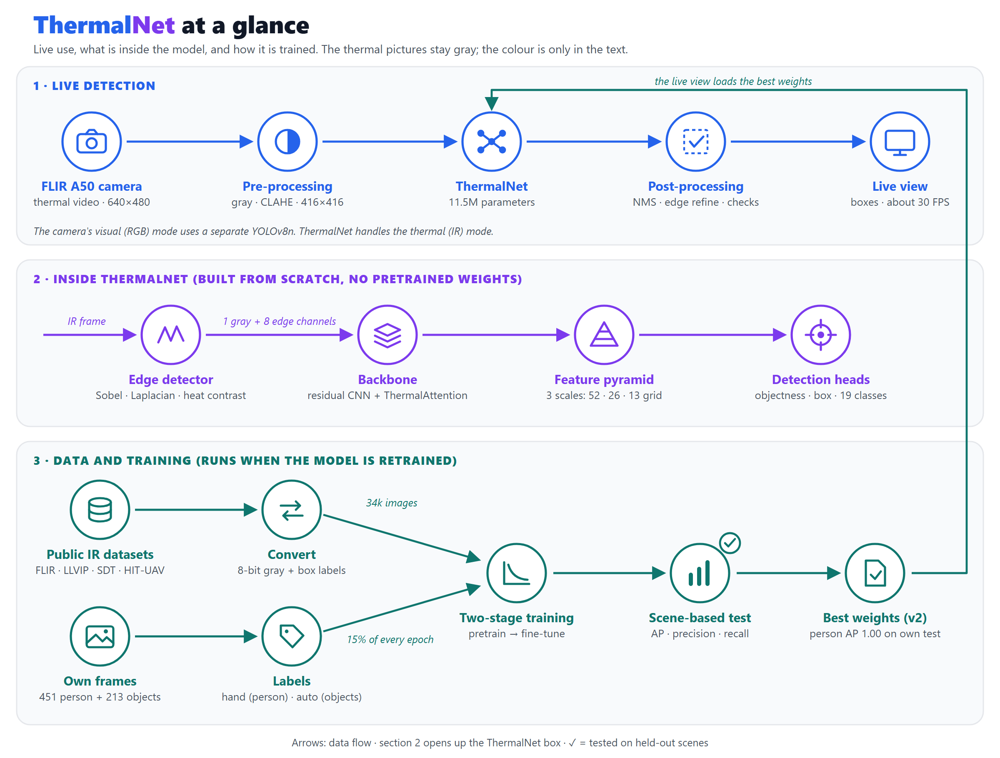
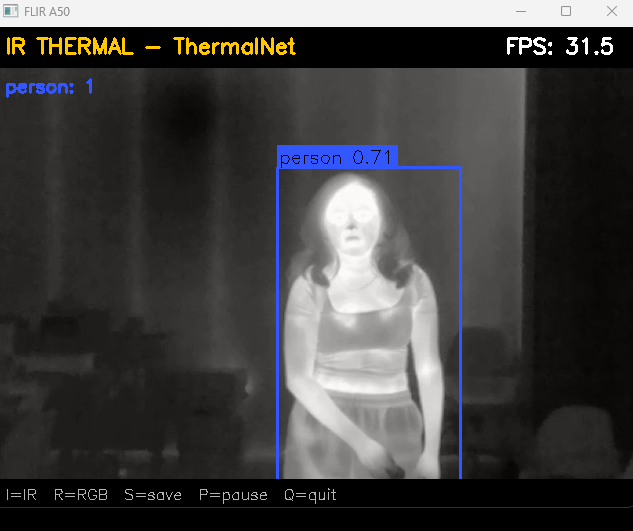
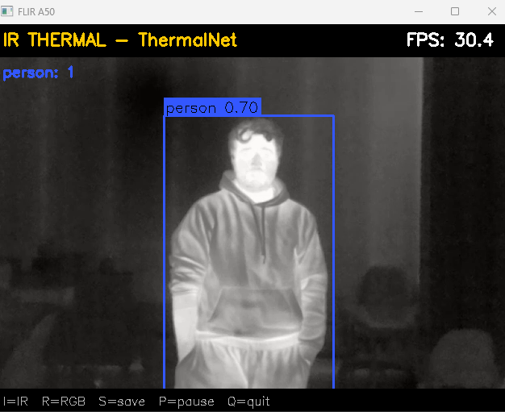
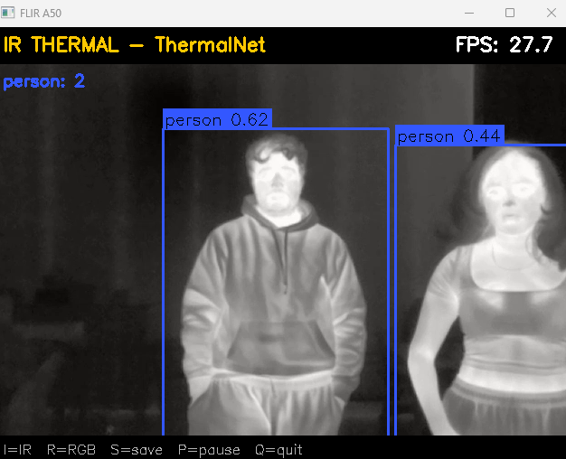
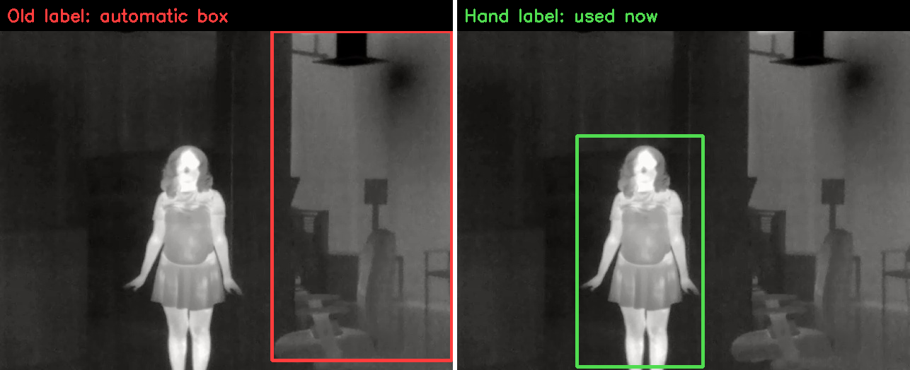
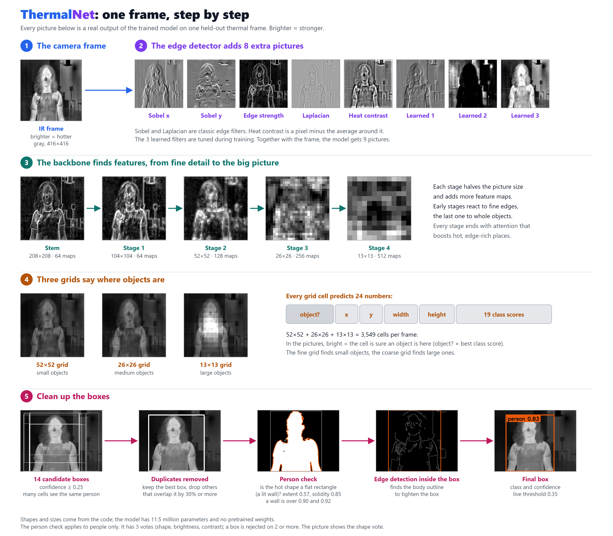

# ThermalNet: a thermal object detector built from scratch for the FLIR A50

> A thermal camera sees heat, not light, so it works in total darkness. But ordinary detectors are trained on colour photos and struggle on flat, low-texture thermal images. ThermalNet is an object detector I built from scratch in PyTorch for a **FLIR A50** thermal camera. It uses **no YOLO, no Roboflow and no pretrained weights**, looks for edges and heat contrast inside the model and again inside every box it draws, and finds people live at about 30 frames per second.

**Author:** Jyothsna Anne · **Source code:** private repository, available on request

**Portfolio deck:** [View the slides (PDF)](ThermalNet_Portfolio.pdf) · [Download the PowerPoint](docs/ThermalNet_Portfolio.pptx)

**How the numbers are calculated:** [`docs/FORMULAS.md`](docs/FORMULAS.md) (every formula, with a worked example)

## Who uses it, and what they see

There is no website or login. ThermalNet is a program with three kinds of use:

| User | What they do | What they see |
|---|---|---|
| **Operator** | Starts the live view with the camera connected | A live thermal picture with boxes, labels, confidence and the frame rate. Key `I` = thermal (ThermalNet), `R` = visible (a separate YOLOv8n), `S` = save, `P` = pause |
| **Data collector** | Captures frames from the camera, draws boxes in a labelling tool, converts them to training data | Their own camera's frames turned into training data, for any class |
| **Developer** | Trains the model, scores it on held-out frames, builds a comparison report | Numbers per class (AP, precision, recall), example images, and an HTML report comparing model versions |

## Screenshots

### Operator: live detection (thermal mode)

**A person found live at confidence 0.71, about 31 FPS.** The thermal camera needs no light; the model works from heat patterns.

| Another person | Two people at once |
|---|---|
|  |  |
| **A second person, never in the training data, at 0.70.** | **Both found together; the right one is partly out of frame.** |

### Developer: the bug behind the poor early results

**The training label was wrong.** All 451 person labels were automatic boxes around the warm wall (left), not the person. The hand labels (right) sat in a folder the script never read. Rebuilding the labels raised person accuracy on held-out frames from 0.23 to 0.98.

## Results

Person detection, **AP@0.5** (1.00 is perfect). The own-data test frames are held out **by scene**, so near-identical video frames can't leak between training and test.

| Model | Own test frames (60 people, A50) | SDT indoor (held-out frames) | LLVIP night (official test scenes) | FLIR ADAS street (val) |
|---|---|---|---|---|
| Own data only, automatic labels | 0.23 | 0.33 | 0.00 | 0.00 |
| Own data only, hand labels | 0.98 | 0.51 | 0.00 | 0.00 |
| **Public pretraining + fine-tune (v2)** | **1.00** | **0.94** | **0.70** | **0.34** |

On the own test frames v2 finds all 60 people with 5 false boxes (precision 0.92, recall 1.00). The three public columns each use 600 evenly spaced validation images.

**Per-class results on the own test frames (v2)**

| Good | Weak | Not detected yet |
|---|---|---|
| glasses 1.00, person 1.00, bag 0.89, laptop 0.83, hat 0.67 | chair 0.44, phone 0.21, book 0.17, bottle 0.02 | cup, key, lamp, candle (fabric, fork and lunchbox have no test images) |

**Read these numbers with care.**
- The own test set is **one person in one room**, so 1.00 is not a general claim. Live tests with other people (screenshots above) are the better evidence.
- The SDT validation frames come from the same recording sessions as its training frames, so the 0.94 shows what public data adds, not how the model handles brand-new rooms. LLVIP's test scenes are genuinely different from its training scenes.
- Object classes have only 3 to 6 test images and about 15 training images each, with automatic boxes. Their numbers are noisy.

## How it works

Every picture below is a real output of the trained model on one held-out thermal frame. The pictures stay gray; the colour is only in the text.

In words:

1. **Pre-process:** gray, contrast-equalized (CLAHE), 416×416.
2. **Edge detector (inside the model):** Sobel, Laplacian and local heat contrast plus 3 learned filters give 8 extra channels next to the gray image.
3. **Backbone:** residual convolution blocks with channel and spatial attention ("ThermalAttention") that focus on hot, edge-rich regions.
4. **Feature pyramid and three anchor-free heads** at 52×52, 26×26 and 13×13: each cell predicts objectness, a box and 19 class scores.
5. **Post-processing:** non-maximum suppression, then edge detection **inside each box** to tighten it, and a shape check that rejects flat bright regions (a lit wall) that are not a person.

The model has **11.5 million parameters** and its weights are 46 MB. Every formula, with a worked example computed by the code, is in [`docs/FORMULAS.md`](docs/FORMULAS.md).

**Training:** random weights, then two stages. *Pretrain* on four public thermal datasets plus 15% of each epoch from my own data; *fine-tune* on my own data only, at a 10× lower learning rate. Augmentation is thermal-specific: random zoom in and out (near and far objects), gain, contrast and gamma changes, sensor noise.

| Public dataset | Scene | Train images | People (train) | License |
|---|---|---|---|---|
| [FLIR ADAS v1.3](https://www.oem.flir.com/solutions/automotive/adas-dataset-form/) | street, driving | 13,086 | 41,596 | FLIR's own terms |
| [LLVIP](https://github.com/bupt-ai-cz/LLVIP) (infrared only) | outdoor pedestrians, night | 12,025 | 34,128 | its own terms |
| [SDT](https://zenodo.org/records/4124309) (real recordings only) | indoor rooms, FLIR Lepton | 6,800 | 5,200 | non-commercial research |
| [HIT-UAV](https://github.com/suojiashun/HIT-UAV-Infrared-Thermal-Dataset) | drone view, 60 to 130 m | 2,029 | 8,474 | CC BY 4.0 |

My own data: 664 frames (475 train, 87 validation, 102 test): 451 person frames captured with the A50 and hand-labelled, plus 213 object images from an earlier collection whose boxes were generated automatically. The datasets belong to their owners and are **not** included here.

## Skills demonstrated

### Machine learning
- **Designed and trained a detector from scratch** (no pretrained weights): edge-detection front end, attention backbone, feature pyramid, anchor-free multi-scale heads, with a loss that mixes CIoU box loss, focal objectness loss and class cross-entropy.
- **Two-stage training** (public pretraining, then fine-tuning), weighted sampling that keeps big public datasets from drowning a small own dataset, a cosine learning-rate schedule with warm-up, bfloat16 mixed precision.
- **Thermal-specific augmentation** and a pre-processing path that is identical in training and live use.
- **Diagnosed a failure by evaluating honestly**: found that all person labels were wrong and fixed them (AP 0.23 to 0.98).

### Computer vision and evaluation
- **Scene-based train, validation and test split** (blocks of consecutive frames with guard frames) so near-duplicate video frames can't leak.
- **Own evaluator** for AP, precision and recall per class, and an HTML report that compares four model versions on four test sets.
- Classical vision inside the model's output: adaptive Canny, Otsu, contour refinement and a shape-vote filter.

### Data engineering
- **One adapter per dataset, one shared class map** that converts COCO JSON, Pascal VOC XML and custom label files into one format; 16-bit temperature data stretched to 8-bit gray; bounding-box clipping and tiny-box removal.
- A labelling workflow (capture → labelme → converter) that works for any class and never overwrites earlier data.

### Software engineering, security and operations
- **Single source of truth** for classes and grid sizes (a past bug came from copies drifting apart); new classes are appended so old weights keep loading.
- **Secrets and paths kept out of the code:** the camera's login and every machine-specific path live in a git-ignored settings file; the repository was scanned for secrets before upload.
- **11 automated tests** (model shapes, loss, splits, converters, augmentation, metrics) that need no GPU, camera or data.
- Overnight, unattended training with an automatic report, and a keep-awake helper.

*This project has no LLM agents, web backend or web frontend; the user interface is an OpenCV window.*

## Tech stack

| Area | Tools |
|---|---|
| Model and training | Python 3.10, PyTorch (CUDA), torchvision |
| Vision | OpenCV (CLAHE, Canny, Otsu, RTSP video) |
| Labelling and data | labelme, NumPy, Pascal VOC and COCO converters |
| Reporting | matplotlib, a self-contained HTML report |
| Camera | FLIR A50 over Ethernet (RTSP video, web API for mode switching) |
| Quality | pytest (11 tests) |
| Scripts | PowerShell (download, overnight run, keep-awake) |

## Problems solved along the way

- **Wrong training labels:** every person box covered a warm wall. Found it by building an honest test, fixed it, and documented it with a picture.
- **Test leakage:** a random frame split would have made results look far better than they were; replaced with a scene-based split.
- **Constants out of sync:** the loss used grid sizes for a different input size than the model. Now one definition, checked by a test and by the loss itself.
- **Different data shapes:** street, night, drone and indoor datasets, 16-bit and 8-bit, at resolutions up to 1280×1024, all brought into one format.
- **Street classes leaking indoors:** a chair showing as `car`. Outdoor-only classes are now hidden in the live view; the real fix (labelled chair frames) is a documented next step.
- **Camera login expiring:** mode switching used a stored cookie that expired; the program now says so clearly and reads the cookie from a private settings file.

## Limitations and next steps

- Hand-label indoor objects with the camera's own frames; cup, key, lamp and candle are not detected yet and the chair is weak.
- Test with more people and rooms; the current test set is one person in one room.
- Add KAIST (95,000 thermal frames) and the larger FLIR ADAS v2.
- The shape check and class-agnostic NMS are hand-tuned post-processing; revisit as the model gets stronger.

## Cost

No cloud and no running costs. Training from scratch takes about 3.5 hours on one recent NVIDIA GPU, and fine-tuning about 3 minutes.

## How it was built

The code was written with an AI coding assistant (Claude Code). I collected and labelled the camera data and tested the results on my own camera.

---

© 2026 Jyothsna Anne. All rights reserved, see [LICENSE](LICENSE). The public datasets belong to their owners and are not included.
